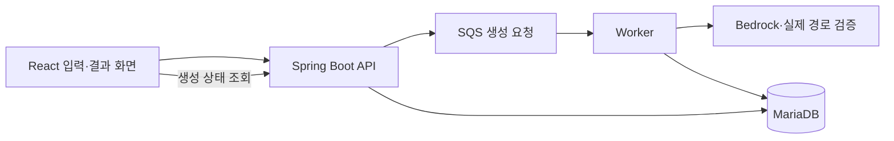

# TripBuddy — 예산에 맞춰 만들고, 여행 중에도 바꾸는 AI 여행 일정

저는 여행자의 불편에서 출발해 **기획·프론트엔드·PM 역할로 팀의 작업을 하나의 서비스로 연결했습니다.** 조건 입력부터 AI 일정 생성, 지도·경비 확인과 모바일 편집까지 구현한 Cloud DX Academy 팀 프로젝트입니다.

**[웹 포트폴리오](https://siu92.github.io/TripBuddy/) · [실제 시연](https://siu92.github.io/TripBuddy/?play=1#demo) · [발표자료 46장](https://siu92.github.io/TripBuddy/#presentation) · [전체 코드 지도](guide/CODE_MAP.md)**

| 완성한 결과 | 제가 맡은 일 | 외부 평가 |
| --- | --- | --- |
| 예산·취향에 맞는 일정 생성과 여행 중 수정 | React 프론트엔드·서비스 기획·PM·API 연동 | 대기업 현직 CTO 평가를 거쳐 팀 프로젝트 장려상 수상 |

## 관심 직무부터 확인하세요

| 분야 | 확인할 구현 | 바로가기 |
| --- | --- | --- |
| **프론트엔드** | 조건 입력·상태·일정 편집·지도·모바일 | [프론트 안내](frontend/README.md) · [화면](frontend/src/App.jsx) · [상태 조율](frontend/src/hooks/useTripPlanner.js) |
| **백엔드·풀스택** | API 계약·비동기 생성·결과 검증·편집 저장 | [백엔드 안내](backend/README.md) · [생성 API](frontend/src/api/tripPlanApi.js) · [서버 생성](backend/src/main/java/com/travel/trip/plan/service/TripPlanService.java) |
| **AWS·DevOps** | API/Worker 분리·SQS·배포 구성 | [전체 구조](guide/ARCHITECTURE.md) · [배포 자료](guide/operations/README.md) · [K8s](backend/k8s) |
| **기획·협업** | 문제 발견·입력 설계·파트별 작업 연결 | [제 역할과 판단](guide/PROJECT.md) · [웹 사례](https://siu92.github.io/TripBuddy/#role) |

프론트엔드는 제가 담당했습니다. 백엔드·AWS·DevOps는 각 담당자와 협업한 팀 구현이며, 아래 기술 구성 전체를 제 단독 구현으로 제시하지 않습니다.

## 서비스는 이렇게 연결됩니다



저는 **예산 → 출발지·목적지 → 날짜 → 교통·숙소 → 취향** 순서로 조건을 연결하고, 서버의 생성·대기·오류 상태를 화면으로 전달했습니다. 생성 이후에는 방문 순서와 장소를 수정하고 변경된 경로를 확인할 수 있게 했습니다.

[전체 흐름과 편집 저장 경계](guide/ARCHITECTURE.md) · [실제 일정 편집 화면](https://siu92.github.io/TripBuddy/#result)

## 기술과 폴더

| 구분 | 구성 | 위치 |
| --- | --- | --- |
| 프론트엔드 | React 19 · Vite 8 · Tailwind CSS 4 · Axios · Kakao Maps | [frontend](frontend) |
| 백엔드 | Java 21 · Spring Boot 4 · JPA · Security · JWT | [backend](backend) |
| AI·데이터·실행 | Bedrock · SQS · MariaDB · Redis · Docker · EKS | [구조와 코드](guide/ARCHITECTURE.md) |
| 개발 안내 | 기능별 코드 지도·실행·팀 기여·배포 자료 | [guide](guide) |
| 웹 포트폴리오 | GitHub Pages · 영상·실제 화면·발표자료 | [docs](docs) |

```text
TripBuddy/
├─ README.md       프로젝트 요약과 직무별 탐색
├─ frontend/       React 화면·API 연동·계산·테스트
├─ backend/        도메인 API·추천·AI·편집·배포 설정
├─ guide/          구조·코드 지도·실행·개발 기록
├─ .github/        통합 저장소의 테스트·빌드 검사
└─ docs/           공개 웹 포트폴리오와 시연 자료
```

## 실행·검증·자료

**[로컬 실행과 검증](guide/DEVELOPMENT.md) · [프론트 테스트](frontend/tests) · [백엔드 테스트](backend/src/test) · [자동 검사](.github/workflows/code-checks.yml)**

프론트는 Node.js, 백엔드는 JDK 21이 필요합니다. 실제 데이터·AI 생성에는 DB·API 키·AWS 환경이 추가로 필요합니다. 현재 공개 저장소의 CI는 **검사만 수행하며 AWS에 배포하지 않습니다.**

| 자료 | 웹에서 보기 | 다운로드 |
| --- | --- | --- |
| 실제 시연 · 1080p / 약 6분 21초 | [영상](https://siu92.github.io/TripBuddy/#demo) | [MP4](https://github.com/siu92/TripBuddy/releases/download/demo-2026-10-02/TripBuddy_demo.mp4) |
| 기획·구현 발표 · 46장 | [슬라이드](https://siu92.github.io/TripBuddy/#presentation) | [PPT](https://github.com/siu92/TripBuddy/releases/download/demo-2026-10-02/TripBuddy_presentation.pptx) |

실습용 AWS 환경은 종료됐습니다. 구현 결과는 위 영상·발표자료·코드로 확인하실 수 있습니다. 대표 시연은 제주 2박 3일이며 항공·숙소 금액은 예상 견적, 렌터카 업체·가격은 시연용 데이터입니다. 실제 결제·예약 확정 기능과 구분합니다.

개발은 별도 팀 저장소에서 진행했습니다. 이 공개 저장소의 커밋 수가 전체 개발 이력이나 개인 기여량을 뜻하지는 않습니다. [본인 기여·팀 개발 이력·검증 범위](guide/PROJECT.md)
