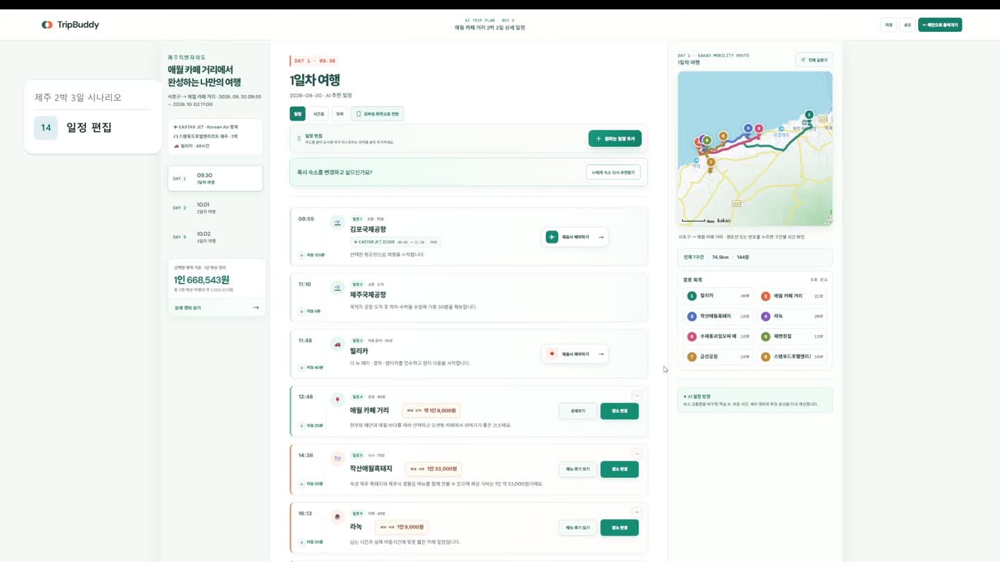
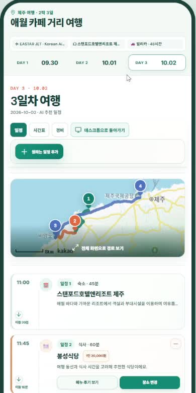
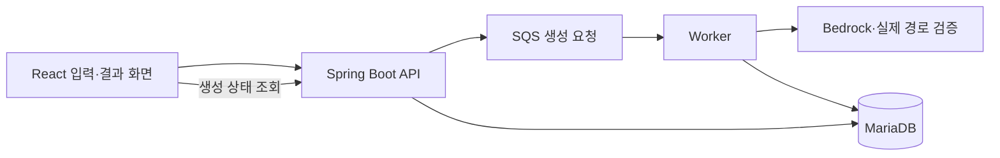

# TripBuddy

### 여행의 조건을 연결해, 계획부터 변경까지

[](https://github.com/siu92/TripBuddy/actions/workflows/code-checks.yml)

**[실제 시연 보기](https://siu92.github.io/TripBuddy/?play=1#demo) · [웹 포트폴리오](https://siu92.github.io/TripBuddy/) · [문제 해결 사례](guide/DECISIONS.md) · [핵심 코드 지도](guide/CODE_MAP.md)**

저는 여행을 준비할 때마다 장소·동선·예산을 여러 서비스에서 다시 맞춰야 하는 불편에 주목했습니다. **프론트엔드와 PM을 맡아, 팀과 함께 예산에 맞는 일정 생성부터 여행 중 수정까지 하나의 서비스로 완성했습니다.**

<table>
  <tr>
    <td width="78%" align="center"><a href="https://siu92.github.io/TripBuddy/?play=1#demo"></a></td>
    <td width="22%" align="center"><a href="https://siu92.github.io/TripBuddy/#mobile"></a></td>
  </tr>
  <tr><td align="center">PC · 일정과 경비, 이동 경로를 함께 확인</td><td align="center">Mobile · 여행 중 확인·수정</td></tr>
</table>

| 완성한 서비스 | 제가 맡은 역할 | 프로젝트 결과 |
| --- | --- | --- |
| 여행 조건 입력 → AI 생성 → 직접 편집 → 모바일 활용 | 서비스 기획·React 개발·PM·API 연동 | 기획부터 배포·발표까지 완수, 대기업 현직 CTO 평가를 거쳐 팀 프로젝트 장려상 수상 |

## 기술을 선택한 이유를 코드로 보여드립니다

| 마주한 조건 | 제가 구현한 처리 | 근거 |
| --- | --- | --- |
| AI 생성 요청이 접수돼도 결과는 아직 없습니다. | 접수·처리·완료·실패를 구분하고 결과가 준비된 뒤 화면에 연결했습니다. | [API 코드](frontend/src/api/tripPlanApi.js) · [상태 전환 검사](frontend/tests/tripPlanPolling.test.mjs) |
| 같은 항공 검색이 겹치고, 계정이나 취소 조건이 달라질 수 있습니다. | 진행 중 요청은 공유하되 세션 변경·오류·개별 취소를 분리했습니다. | [검색 어댑터](frontend/src/api/flightApi.js) · [회귀 검사](frontend/tests/flightSearchCache.test.mjs) |
| 화면의 편집 배열을 그대로 저장하면 고정 항공·숙소와 서버 식별자가 섞일 수 있습니다. | 원본 식별자로 편집 요청을 만들고 고정 항목은 유지했습니다. 서버 담당자와 revision·재계산 계약을 연결했습니다. | [편집 payload](frontend/src/utils/planEditPayload.js) · [고정 일정 검사](frontend/tests/planEditPayload.test.mjs) |

[문제 → 판단 → 구현 → 검증을 자세히 보기](guide/DECISIONS.md)

## 관심 직무부터 확인하세요

| 분야 | 확인할 구현 | 바로가기 |
| --- | --- | --- |
| **프론트엔드** | 조건 입력·상태·일정 편집·지도·모바일 | [프론트 안내](frontend/README.md) · [화면](frontend/src/App.jsx) · [상태 조율](frontend/src/hooks/useTripPlanner.js) |
| **백엔드·풀스택** | API 계약·비동기 생성·결과 검증·편집 저장 | [백엔드 안내](backend/README.md) · [생성 API](frontend/src/api/tripPlanApi.js) · [서버 생성](backend/src/main/java/com/travel/trip/plan/service/TripPlanService.java) |
| **AWS·DevOps** | API/Worker 분리·SQS·배포 구성 | [전체 구조](guide/ARCHITECTURE.md) · [배포 자료](guide/operations/README.md) · [K8s](backend/k8s) |
| **기획·협업** | 문제 발견·입력 설계·파트별 작업 연결 | [제 역할과 판단](guide/PROJECT.md) · [웹 사례](https://siu92.github.io/TripBuddy/#role) |

프론트엔드는 제가 담당했습니다. 백엔드·AWS·DevOps는 각 담당자와 협업한 팀 구현이며, 아래 기술 구성 전체를 제 단독 구현으로 제시하지 않습니다.

## 서비스는 이렇게 연결됩니다



저는 **예산 → 출발지·목적지 → 날짜 → 교통·숙소 → 취향** 순서로 조건을 연결하고, 서버의 생성·대기·오류 상태를 화면으로 전달했습니다. 생성 이후에는 방문 순서와 장소를 수정하고 변경된 경로를 확인할 수 있게 했습니다.

[전체 흐름과 편집 저장 경계](guide/ARCHITECTURE.md) · [실제 일정 편집 화면](https://siu92.github.io/TripBuddy/#result)

## 기술과 폴더

| 구분 | 구성 | 위치 |
| --- | --- | --- |
| 프론트엔드 | React 19 · Vite 8 · Tailwind CSS 4 · Axios · Kakao Maps | [frontend](frontend) |
| 백엔드 | Java 21 · Spring Boot 4 · JPA · Security · JWT | [backend](backend) |
| AI·데이터·실행 | Bedrock · SQS · MariaDB · Redis · Docker · EKS | [구조와 코드](guide/ARCHITECTURE.md) |
| 개발 안내 | 기능별 코드 지도·실행·팀 기여·배포 자료 | [guide](guide) |
| 웹 포트폴리오 | GitHub Pages · 영상·실제 화면·발표자료 | [docs](docs) |

```text
TripBuddy/
├─ README.md       프로젝트 요약과 직무별 탐색
├─ frontend/       React 화면·API 연동·계산·테스트
├─ backend/        도메인 API·추천·AI·편집·배포 설정
├─ guide/          구조·코드 지도·실행·개발 기록
├─ .github/        통합 저장소의 테스트·빌드 검사
└─ docs/           공개 웹 포트폴리오와 시연 자료
```

## 검증 결과도 직접 확인할 수 있습니다

| 프론트엔드 | 백엔드 | 화면·문서 |
| --- | --- | --- |
| **48개 테스트 통과** · 일반 빌드 성공 | **141개 테스트 통과** · JDK 21 / 테스트 프로필 | PC·모바일 입력과 새로고침 복원 확인 |

2026-10-31 검증 기록입니다. 테스트 수는 사용자 성과나 커버리지 비율이 아니며, 실행 범위와 한계는 [검증 기록](guide/VERIFICATION.md)에 구분했습니다. 상단 CI 배지는 `main`의 자동 검사 상태로 연결됩니다.

## 실행·자료

**[로컬 실행과 검증](guide/DEVELOPMENT.md) · [프론트 테스트](frontend/tests) · [백엔드 테스트](backend/src/test) · [자동 검사](.github/workflows/code-checks.yml)**

프론트는 Node.js, 백엔드는 JDK 21이 필요합니다. 실제 데이터·AI 생성에는 DB·API 키·AWS 환경이 추가로 필요합니다. 공개 저장소의 CI는 테스트·빌드를 자동으로 검사합니다.

| 자료 | 웹에서 보기 | 다운로드 |
| --- | --- | --- |
| 실제 시연 · 1080p / 약 6분 21초 | [영상](https://siu92.github.io/TripBuddy/#demo) | [MP4](https://github.com/siu92/TripBuddy/releases/download/demo-2026-10-02/TripBuddy_demo.mp4) |
| 기획·구현 발표 · 46장 | [슬라이드](https://siu92.github.io/TripBuddy/#presentation) | [PPT](https://github.com/siu92/TripBuddy/releases/download/demo-2026-10-02/TripBuddy_presentation.pptx) |

실습용 AWS 환경은 종료됐습니다. 구현 결과는 위 영상·발표자료·코드로 확인하실 수 있습니다. 대표 시연은 제주 2박 3일이며 항공·숙소 금액은 예상 견적, 렌터카 업체·가격은 시연용 데이터입니다. 실제 결제·예약 확정 기능과 구분합니다.

개발은 별도 팀 저장소에서 진행했습니다. 이 공개 저장소의 커밋 수가 전체 개발 이력이나 개인 기여량을 뜻하지는 않습니다. [본인 기여·팀 개발 이력·검증 범위](guide/PROJECT.md)

다음 개선은 [브라우저 회귀 검사 → 자산 최적화 → 남은 상태·CSS 분리](guide/NEXT_STEPS.md) 순서로 정리했습니다.
