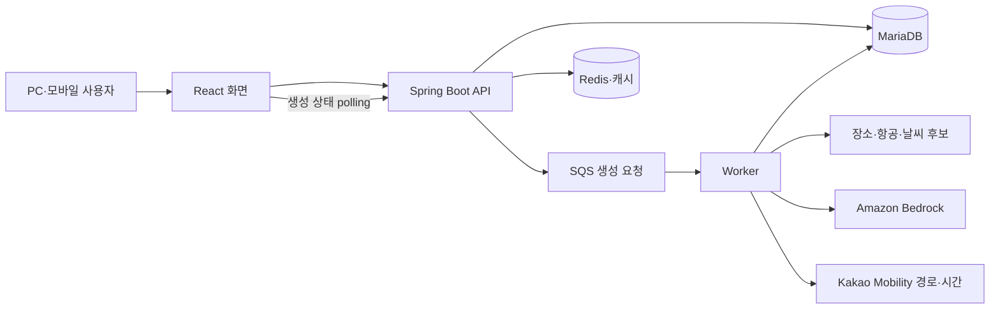

# 전체 시스템과 협업 경계

저는 React 화면과 PM 역할을 맡아 입력·요청·생성 상태·편집 결과를 연결했습니다. 백엔드·AWS·DevOps 구현은 각 담당자와 협업한 팀 결과입니다.

## 생성: 빠른 요청과 오래 걸리는 작업을 구분합니다

1. 화면에서 예산·날짜·교통·숙소·취향을 확보하고 여행 조건을 저장합니다.
2. API는 생성 작업을 접수하고 SQS에 메시지를 발행합니다.
3. Worker는 실제 데이터의 후보를 좁힌 뒤 Bedrock에 일정 구성을 요청합니다.
4. 서버는 결과를 검증하고 실제 이동시간·식사·귀환 조건을 보정해 저장합니다.
5. 화면은 상태를 조회해 대기·완료·오류를 구분하고 완성된 일정을 표시합니다.

[프론트 요청 경계](../frontend/src/api/tripPlanApi.js) · [백엔드 비동기 구성](../backend/ASYNC_TRIP_PLAN.md)

## 수정: 화면 초안과 서버 저장은 다릅니다

화면의 순서 변경·추가·제외 초안은 로컬 상태입니다. 서버 저장 시에는 편집 요청을 구성하고 소유권·작업 상태·revision을 검증한 뒤 변경된 날짜의 경로·시간·이동비를 다시 계산합니다. 로컬에서 바뀐 상태를 서버 저장 완료로 취급하지 않습니다.

[편집 payload](../frontend/src/utils/planEditPayload.js) · [서버 편집](../backend/src/main/java/com/travel/trip/plan/edit/PlanEditService.java)

## 배포: 같은 코드라도 API와 Worker의 실행 역할이 다릅니다

정적 프론트엔드는 S3·CloudFront, 서버의 API와 Worker는 EKS의 별도 실행 단위로 구성했습니다. 백엔드 이미지는 같고 `APP_RUNTIME_ROLE`로 역할을 나눕니다. Redis·SQS·RDS 등은 팀의 실행 구성입니다.

이 공개 저장소에는 백엔드 Docker/K8s 설정과 기존 파이프라인 참고본이 있습니다. AWS 자원 전체를 재생성하는 IaC가 모두 포함된 저장소는 아닙니다. 현재 CI는 코드 검사만 수행합니다. [배포 자료 안내](operations/README.md)

## 데이터와 확인 범위

날씨·장소·지도 경로는 외부 API와 백엔드 데이터를 활용합니다. 항공·숙소 금액은 예상 견적이며, 렌터카 업체·가격과 일부 대체 상세는 시연용 데이터입니다. 실제 결제·예약 확정이나 모든 국내 지역의 품질 검증을 의미하지 않습니다.

실습용 AWS 환경은 종료됐습니다. 완성된 사용자 흐름과 팀의 설계는 [영상·발표자료](https://siu92.github.io/TripBuddy/) 및 코드로 확인하실 수 있습니다.
