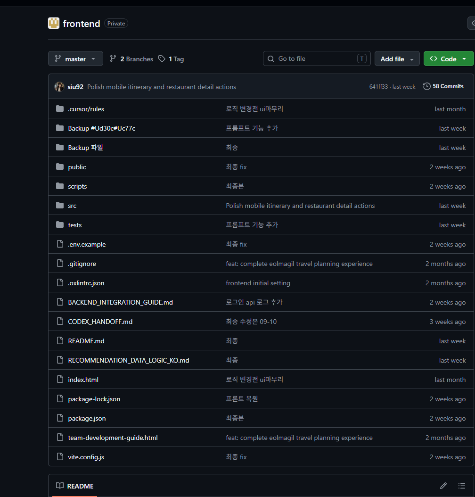
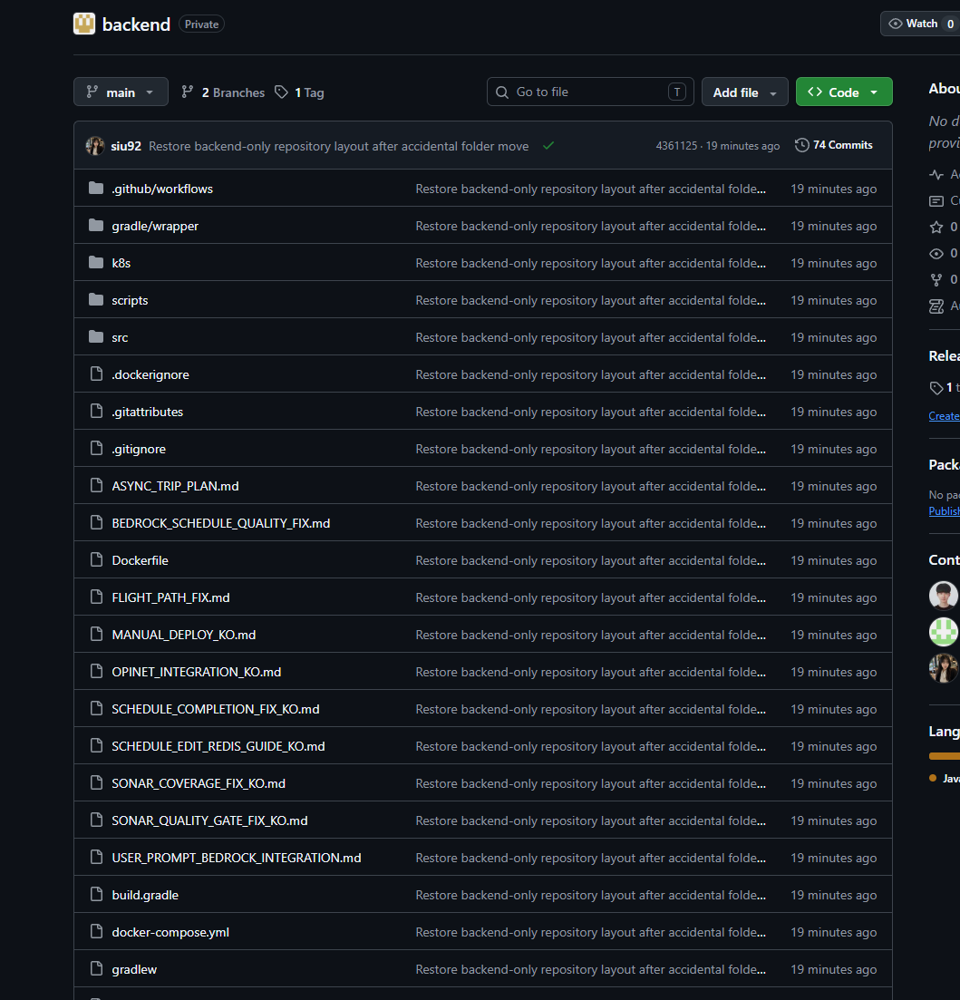

# 프로젝트와 제가 맡은 역할

저는 여행을 준비하며 장소와 이동시간, 예산을 여러 서비스에서 다시 맞추는 불편을 느꼈습니다. 공개 조사와 이용 후기를 검토한 뒤, 팀과 함께 예산·취향에 맞는 일정을 만들고 여행 중에도 장소와 순서를 수정하는 TripBuddy를 구현했습니다.

## 제가 직접 담당한 부분

- **서비스 기획·PM:** 프로젝트 타임라인, 팀원별 역할과 기한, 진행 상황을 관리했습니다. 멘토링 자료와 회의를 준비하고 발표·시연까지 작업을 연결했습니다.
- **프론트엔드:** 여행 조건의 입력 순서, React PC·모바일 화면, 지도·일정 편집·예상 경비를 구현했습니다.
- **연동·협업:** 백엔드 담당자와 요청·응답과 생성 상태를 맞추고 배포 환경에서 화면과 API의 연결을 확인했습니다. 백엔드·AWS·DevOps의 모든 구현을 제가 단독 수행한 것은 아닙니다.

기획부터 개발·배포·발표까지 연결된 프로젝트를 끝까지 경험했습니다. 대기업 현직 CTO들의 평가를 거쳐 팀 프로젝트 장려상을 수상했습니다.

## 설계를 바꾼 사례

예산을 첫 입력에 두어 이후 선택의 기준으로 삼았습니다. 공통 날짜 화면에 있던 출발시각은 항공·KTX의 티켓 시각과 중복되므로 제거하고, 자차를 선택한 경우에만 직접 설정하도록 바꿨습니다.

[판단과 화면 근거](https://siu92.github.io/TripBuddy/#ux) · [실제 시연](https://siu92.github.io/TripBuddy/#demo)

## 공개 코드와 원래 개발 이력

이 저장소는 프론트엔드·백엔드의 별도 팀 저장소에서 개발한 결과를 모은 공개 포트폴리오입니다. 이 저장소의 커밋 수와 기여자 표시를 전체 개발 이력이나 개인별 기여량으로 해석하지 않습니다.

아래는 2026년 10월 2일 기준 보존한 비공개 팀 저장소 화면입니다. 프론트엔드 58개·백엔드 74개 커밋은 해당 시점의 화면에 표시된 값입니다.

팀 저장소 개발 이력 화면

## 구현과 검증 범위

대표 시연은 3인 제주 2박 3일입니다. 날짜별 일정·경로·예상 경비와 모바일 편집을 확인하실 수 있습니다. 지역 데이터 확보를 전제로 다른 국내 지역에도 같은 흐름을 적용하도록 설계했으며, 전국 모든 지역의 품질이나 실제 예약·결제는 검증한 범위가 아닙니다.

입력 순서의 효과나 이탈률 개선을 입증한 사용자 실험 수치는 제시하지 않았습니다. 향후에는 일정 만들기·식당 교체하기 과제로 혼란과 되돌아가기, 변경 경로의 이해를 확인하려 합니다. 이는 완료된 조사가 아닌 다음 검증 과제입니다.

구현 과정에서 AI 도구를 활용했고 요구사항 구체화·결과 확인·반복 수정에 집중했습니다. [화면·영상·발표자료](https://siu92.github.io/TripBuddy/)에서 결과와 근거를 확인하실 수 있습니다.
